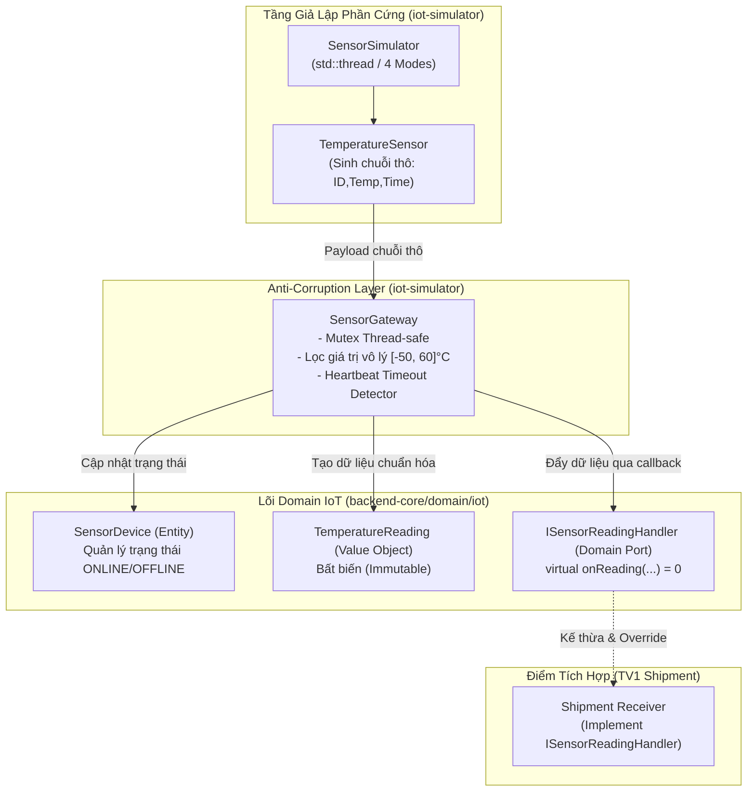

# Phân Hệ Sensing & IoT (TV2) — Cold Chain Logistics

Tài liệu kỹ thuật và hướng dẫn vận hành phân hệ **Sensing (IoT)** thuộc dự án Quản lý Chuỗi Cung Ứng Lạnh. Phân hệ được thiết kế theo phương pháp **Domain-Driven Design (DDD)**, áp dụng mô hình **Anti-Corruption Layer (ACL)** và mô phỏng cảm biến đa luồng (**Multi-threading**).

---

## 1. Vai Trò & Phạm Vi Phụ Trách (TV2 Scope)

* **Thành viên:** TV2
* **Bounded Context:** Sensing (IoT)
* **Thư mục sở hữu:**
  * `backend-core/domain/iot/` (Lõi nghiệp vụ IoT)
  * `iot-simulator/` (Bộ giả lập phần cứng & Gateway ACL)
  * `tests/test_iot.cpp` (Kiểm thử tự động phân hệ IoT)
* **Sản phẩm chính:**
  1. **Lõi Domain IoT:** Entity `SensorDevice`, Value Object bất biến `TemperatureReading`, và Domain Port `ISensorReadingHandler`.
  2. **Anti-Corruption Layer (ACL) — `SensorGateway`:** Phân tích, lọc nhiễu/lỗi từ chuỗi dữ liệu thô của phần cứng, bảo vệ Domain Core không bị ô nhiễm bởi dữ liệu bẩn. Đảm bảo an toàn đa luồng (`std::mutex`) và tự động phát hiện mất kết nối (Heartbeat Timeout).
  3. **Bộ giả lập cảm biến đa luồng — `SensorSimulator`:** Chạy độc lập trên luồng nền (`std::thread`), hỗ trợ 4 kịch bản vận hành thực tế.
  4. **Bộ kiểm thử tự động (Unit Tests):** 6/6 test cases đạt chuẩn chất lượng 100%.

---

## 2. Kiến Trúc Phân Hệ & DDD Mapping



---

## 3. Các Thành Phần Kỹ Thuật Chính

### 3.1. Lõi Domain IoT (`backend-core/domain/iot/`)
* **`TemperatureReading` (Value Object):**
  * Đại diện cho một lần đo nhiệt độ chuẩn hóa.
  * Bất biến (Immutable), gồm: `sensorId`, `celsius`, `timestamp`.
  * Ràng buộc: `sensorId` không được để trống; so sánh theo giá trị (`operator==`).
* **`SensorDevice` (Entity):**
  * Đại diện cho thiết bị cảm biến vật lý gắn trong thùng lạnh.
  * Quản lý trạng thái hoạt động: `ONLINE`, `OFFLINE`, `FAULTY`.
  * Validate giới hạn vật lý: Loại bỏ giá trị ngoài dải $[-50^\circ\text{C}, 60^\circ\text{C}]$.
  * Cập nhật thời điểm nhận tín hiệu cuối cùng (`lastHeartbeat`).
* **`ISensorReadingHandler` (Domain Port):**
  * Áp dụng nguyên lý **Dependency Inversion (DIP)**.
  * Giao diện callback `virtual void onReading(const TemperatureReading& reading) = 0`. TV1 (phân hệ Shipment) implement interface này để tiếp nhận dữ liệu.

### 3.2. Cổng Gateway & Anti-Corruption Layer (`iot-simulator/`)
* **`SensorGateway`:**
  * Tiếp nhận chuỗi thô (VD: `"SENSOR-01,4.5"` hoặc `"SENSOR-01,4.5,2026-10-13 19:00:00"`).
  * Kiểm tra định dạng, loại bỏ chuỗi rác, lọc giá trị phi lý.
  * Sử dụng `std::mutex` đảm bảo an toàn tuyệt đối khi nhiều cảm biến đẩy dữ liệu đồng thời.
  * Tự động chuyển trạng thái cảm biến sang `OFFLINE` nếu quá $N$ giây không nhận được tín hiệu.

### 3.3. Bộ Giả Lập Đa Luồng (`SensorSimulator`)
Vận hành trên luồng ngầm (`std::thread`, `std::atomic<bool>`), hỗ trợ 4 kịch bản:
1. **`STABLE`:** Nhiệt độ ổn định trong ngưỡng an toàn ($2.5^\circ\text{C} - 4.8^\circ\text{C}$).
2. **`DRIFT`:** Mô phỏng sự cố thùng lạnh, nhiệt độ tăng dần đều (gồm trường hợp tăng nhẹ an toàn $< 8.0^\circ\text{C}$ và hỏng nặng vượt ngưỡng $> 8.0^\circ\text{C}$).
3. **`SPIKE`:** Đột biến nhiệt vọt lên ($10.5^\circ\text{C} - 13.2^\circ\text{C}$) trong 1 chu kỳ rồi tự phục hồi (dùng để test cảnh báo Warning).
4. **`NOISE`:** Nhiễu ngẫu nhiên dao động biên độ rộng.

---

## 4. Hợp Đồng Giao Tiếp Với Các Phân Hệ Khác

| Hợp đồng / Đối tượng | Phân hệ liên kết | Hướng tương tác | Mô tả |
| :--- | :--- | :--- | :--- |
| **`ISensorReadingHandler`** | TV1 (Shipment Core) | TV2 gọi $\rightarrow$ TV1 nhận | TV1 kế thừa interface này để nhận `TemperatureReading` mỗi khi Gateway xử lý xong một lần đọc. |
| **`SensorDevice.containerId`** | TV3 (Fleet & Logistics) | TV3 định danh | Gán cảm biến vào container lạnh tương ứng. |
| **4 Kịch bản Simulator** | TV4 (Alerting) | Gián tiếp qua TV1 | Cung cấp nguồn dữ liệu bất thường kích hoạt cảnh báo WARNING và CRITICAL. |

### Ví dụ kết nối nhanh cho TV1 / TV5:
```cpp
#include "backend-core/domain/iot/ISensorReadingHandler.h"
#include "iot-simulator/include/SensorGateway.h"
#include "iot-simulator/include/SensorSimulator.h"

// 1. Phân hệ Shipment (TV1) implement interface:
class ShipmentReceiver : public Domain::IoT::ISensorReadingHandler {
public:
    void onReading(const Domain::IoT::TemperatureReading& reading) override {
        // Nhận dữ liệu sạch đã được chuẩn hóa từ TV2
        std::cout << "[Shipment] Sensor: " << reading.getSensorId() 
                  << " | Temp: " << reading.getCelsius() << " C\n";
    }
};

// 2. Ghép nối và chạy mô phỏng:
int main() {
    auto gateway = std::make_shared<SensorGateway>();
    auto receiver = std::make_shared<ShipmentReceiver>();
    gateway->registerHandler(receiver);

    SensorSimulator simulator(gateway, 1000); // chu kỳ 1 giây
    simulator.addSensor("SENSOR-01");
    simulator.setMode(SimulationMode::STABLE);
    simulator.start(); // Luồng ngầm bắt đầu chạy

    std::this_thread::sleep_for(std::chrono::seconds(5));
    simulator.stop();  // Dừng an toàn
    return 0;
}
```

---

## 5. Cấu Trúc File Chi Tiết Thuộc TV2

```text
cold-chain-logistics/
├── backend-core/
│   └── domain/
│       └── iot/
│           ├── TemperatureReading.h       # [Value Object] Dữ liệu nhiệt độ bất biến
│           ├── ISensorReadingHandler.h    # [Domain Port] Callback interface cho TV1
│           ├── SensorDevice.h             # [Entity] Quản lý thiết bị & validation
│           └── SensorDevice.cpp           # [Entity Logic] Cập nhật heartbeat & trạng thái
│
├── iot-simulator/
│   ├── include/
│   │   ├── SensorData.h                   # Struct raw data
│   │   ├── Sensor.h                       # Cảm biến cơ sở
│   │   ├── TemperatureSensor.h            # Cảm biến nhiệt độ phần cứng
│   │   ├── SensorGateway.h                # Header ACL Gateway (Mutex, Timeout)
│   │   └── SensorSimulator.h              # Header Simulator đa luồng (4 Modes)
│   └── src/
│       ├── SensorData.cpp
│       ├── Sensor.cpp
│       ├── TemperatureSensor.cpp
│       ├── SensorGateway.cpp              # Logic ACL, lọc dữ liệu dị thường
│       ├── SensorSimulator.cpp            # Logic 4 kịch bản mô phỏng đa luồng
│       └── main.cpp                       # Chương trình Console Demo tương tác
│
└── tests/
    └── test_iot.cpp                       # 6 Unit Tests tự động (PASSED 100%)
```

---

## 6. Hướng Dẫn Biên Dịch & Chạy Thử Nghiệm

Mọi thao tác đều thực hiện trên PowerShell tại thư mục gốc dự án:

### 6.1. Chạy Bộ Kiểm Thử Tự Động (Unit Tests)
```powershell
# 1. Biên dịch bộ test
g++ -std=c++17 -Wall -Wextra tests/test_iot.cpp backend-core/domain/iot/SensorDevice.cpp iot-simulator/src/SensorData.cpp iot-simulator/src/SensorGateway.cpp iot-simulator/src/SensorSimulator.cpp iot-simulator/src/Sensor.cpp iot-simulator/src/TemperatureSensor.cpp -o tests/test_iot.exe

# 2. Chạy test (Đạt 6/6 tests PASSED)
.\tests\test_iot.exe
```

### 6.2. Chạy Ứng Dụng Console Demo Tương Tác
```powershell
# 1. Biên dịch ứng dụng Demo
g++ -std=c++17 -Wall -Wextra iot-simulator/src/main.cpp backend-core/domain/iot/SensorDevice.cpp iot-simulator/src/SensorData.cpp iot-simulator/src/SensorGateway.cpp iot-simulator/src/SensorSimulator.cpp iot-simulator/src/TemperatureSensor.cpp iot-simulator/src/Sensor.cpp -o iot-simulator/iot_simulator_demo.exe

# 2. Khởi chạy Demo
.\iot-simulator\iot_simulator_demo.exe
```

---

## 7. Trạng Thái Nhánh Git
* **Nhánh phát triển:** `feature/tv2-sensor` (tách từ `main`).
